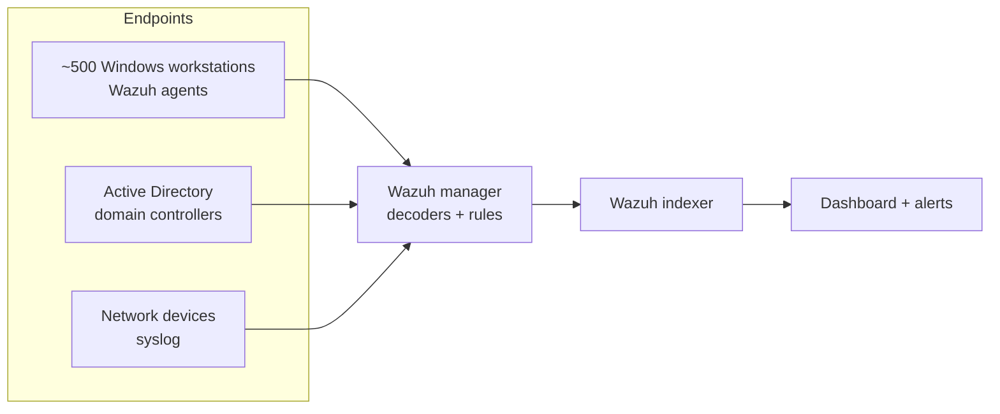
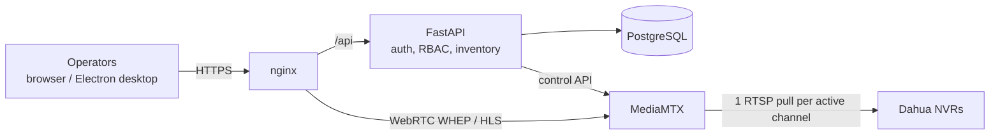
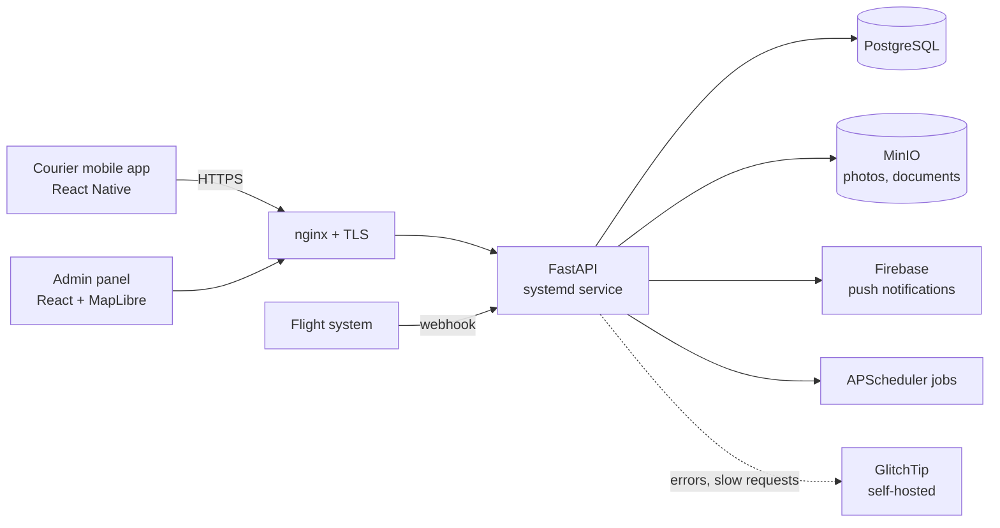
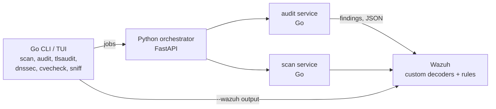
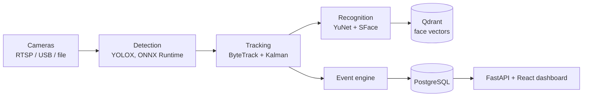

# Rustem Nuryev

**DevOps Engineer with a strong backend background (Golang / FastAPI)**

I build backends, ship them to Linux servers I run myself, and keep them observable and secure.
Field experience with large physical-security deployments: ~1,000 IP cameras, Hikvision access control, Wazuh SIEM across ~500 hosts.

Open to remote work · Ashgabat, Turkmenistan (UTC+5)

<!-- TODO: add LinkedIn badge:  -->

---

## Stack

**Infrastructure & deploy**

**Backend & data**

**Observability & security**

**Networks & physical security**

**Frontend & mobile** (enough to ship the whole product)

---

## Field experience: physical security and SIEM

| Area | Scale | What I did |
|---|---|---|
| **CCTV** | ~1,000 IP cameras | Centralized management server (Hikvision CMS class), NVR integration, network design for video traffic. Wrote a custom VMS (case study below). |
| **Access control (ACS)** | Hikvision | Full cycle: controllers and readers, connection and commissioning, cards and passes, access levels, time schedules. |
| **SIEM** | ~500 workstations | Wazuh: Active Directory log collection, threat detection, traffic monitoring, alerting. |
| **Networks** | multi-site | MikroTik and Cisco configuration, VLAN segmentation, site-to-site VPN, firewall and DNS hardening. |

---

## Featured case studies

### 1. Centralized Video Management System

**Problem.** Dahua NVRs cap the number of simultaneous connections. With many operators watching, NVRs refused new viewers.

**Solution.** A VMS that keeps **one** RTSP session per NVR channel, no matter how many operators watch it. MediaMTX opens the pull on the first viewer and closes it after the last one leaves, so idle channels use zero NVR slots.

**My role.** Architecture, backend, deploy.
**Stack.** FastAPI, async SQLAlchemy, Alembic, PostgreSQL, MediaMTX, WebRTC (WHEP) with HLS fallback, React, Electron.
**Deploy.** Docker Compose in three modes (bridge, host network, fully offline for air-gapped sites), plus a native Windows build. GitHub Actions builds the Windows installer and the desktop client.

More details

- Channel paths are managed dynamically by the backend through the MediaMTX control API.
- Operator grids from 2×2 up to 64×64, patrol mode, saved layouts, snapshots.
- NVR credentials are encrypted at rest; passwords are hashed with argon2.
- Offline compose bundle for sites without internet access.

### 2. Inter-city air-cargo delivery platform

**Problem.** A logistics company delivers parcels between cities by plane. Two couriers per order (pickup to airport, airport to recipient) and flight data from an external system.

**My role.** Backend, infrastructure, deploy, monitoring (578 commits).
**Stack.** FastAPI, SQLAlchemy, Alembic, PostgreSQL (asyncpg), MinIO, APScheduler, Firebase Admin, OTP + JWT auth.
**Deploy.** systemd units behind nginx, Dockerfile and Compose for the backend, self-hosted GlitchTip in Docker for error tracking.

More details

- 17-status order lifecycle with QR codes and full history.
- Courier balances and payouts.
- Webhook integration with the flight schedule system.
- Scheduler failures and slow requests are reported to GlitchTip.

### 3. Network security toolkit with Wazuh integration (open source)

**[yomarakesha/speedtest](https://github.com/yomarakesha/speedtest)**: a Go CLI and terminal dashboard for network diagnostics and security audit. It grew into a microservice system: a Python orchestrator schedules discover and audit jobs, and Go services send findings to Wazuh.

**Stack.** Go, Python, FastAPI, Wazuh, Docker Compose, GitHub Actions, GoReleaser (Linux, macOS, Windows; amd64 + arm64).
**Highlights.** Port scan with banners and fingerprints, subnet discovery (MAC, vendor, SNMP), TLS audit and HTTP security headers graded A–F, DNSSEC/SPF/DMARC checks, CVE matching on banners, traceroute without root, bufferbloat test, packet capture.

### 4. CPU-only video analytics (open source)

**[yomarakesha/korgoz](https://github.com/yomarakesha/korgoz)**: a local-first video analytics platform. Cameras, then detection, tracking, face recognition, events, and analytics. Runs natively on systemd, without Docker, on plain CPUs.

**Stack.** Python, FastAPI, ONNX Runtime, OpenCV, Qdrant, PostgreSQL, SQLAlchemy, Alembic, React, systemd (API and worker units).
**Numbers.** Measured on an Intel Core Ultra 5 125U, CPU only: YOLOX-tiny handles 4 cameras with no frame loss at ~2.5 cores, p95 latency ~0.15 s.

---

## More production work

Client code is private. Short summaries:

| Project | What it is | Stack | Deploy |
|---|---|---|---|
| Parcel-locker platform | Backend, operator web, mobile app and a lock agent on the locker device | FastAPI, PostgreSQL, Flutter, Node | systemd agent on device, contract tests (Schemathesis) |
| Marketplace | Storefront, admin panel and mobile app for a national postal operator | FastAPI, MySQL, React, Expo | systemd + nginx |
| E-shop + CRM | Shop for IT and security hardware, admin CRM with RBAC | FastAPI, SQLite, React | systemd + nginx, GitHub Actions CI |
| Job board | Server-rendered, works without JavaScript on slow mobile networks | FastAPI, Next.js | Docker Compose |
| Legal and HR suite | Contract workflow, approvals, HR | Django REST (v1), then NestJS + Prisma + tRPC monorepo (pnpm, Turborepo), React | Docker Compose + nginx |

---

English · Русский по запросу
