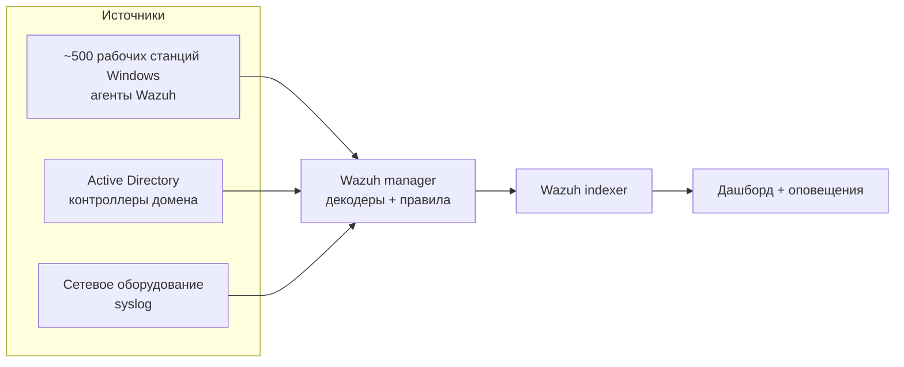
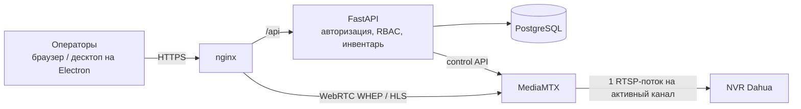
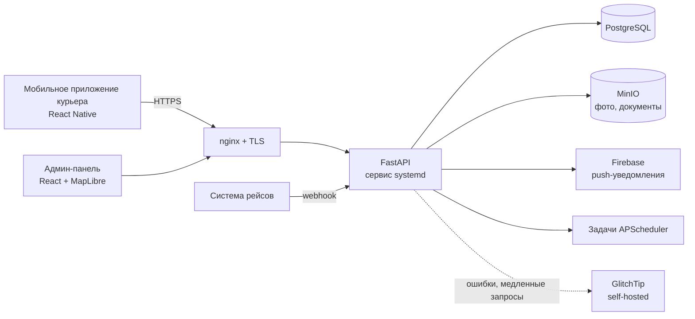
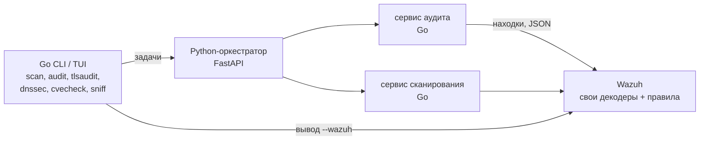
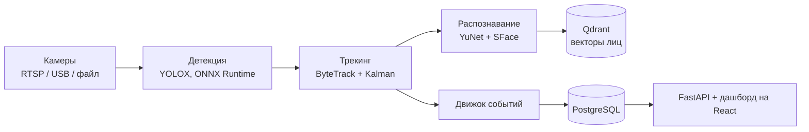

# Рустем Нурыев

[English](README.md) · **Русский**

**DevOps-инженер с сильным backend-бэкграундом (Golang / FastAPI)**

Пишу бэкенды, разворачиваю их на Linux-серверах, которые сам администрирую, и слежу, чтобы они были наблюдаемыми и защищёнными.
Полевой опыт на крупных объектах физической безопасности: ~1000 IP-камер, СКУД Hikvision, SIEM Wazuh на ~500 хостах.

Открыт к удалённой работе · Ашхабад, Туркменистан (UTC+5)

<!-- TODO: add LinkedIn badge:  -->

---

## Стек

**Инфраструктура и деплой**

**Backend и данные**

**Наблюдаемость и безопасность**

**Сети и физическая безопасность**

**Frontend и мобильная разработка** (достаточно, чтобы довести продукт целиком)

---

## Полевой опыт: физическая безопасность и SIEM

| Направление | Масштаб | Что делал |
|---|---|---|
| **Видеонаблюдение** | ~1000 IP-камер | Централизованный сервер управления (класса Hikvision CMS), интеграция NVR, проектирование сети под видеотрафик. Написал собственную VMS (кейс ниже). |
| **СКУД** | Hikvision | Полный цикл: контроллеры и считыватели, подключение и пусконаладка, карты и пропуска, уровни доступа, графики. |
| **SIEM** | ~500 рабочих станций | Wazuh: сбор логов Active Directory, обнаружение угроз, мониторинг трафика, оповещения. |
| **Сети** | несколько площадок | Настройка MikroTik и Cisco, сегментация VLAN, site-to-site VPN, защита firewall и DNS. |

---

## Основные кейсы

### 1. Централизованная система управления видео (VMS)

**Проблема.** NVR Dahua ограничивают число одновременных подключений. Когда смотрят много операторов, NVR отказывают новым зрителям.

**Решение.** VMS держит **одну** RTSP-сессию на канал NVR, сколько бы операторов его ни смотрели. MediaMTX открывает поток при первом зрителе и закрывает после ухода последнего, поэтому неактивные каналы не занимают слоты NVR.

**Моя роль.** Архитектура, backend, деплой.
**Стек.** FastAPI, async SQLAlchemy, Alembic, PostgreSQL, MediaMTX, WebRTC (WHEP) с откатом на HLS, React, Electron.
**Деплой.** Docker Compose в трёх режимах (bridge, host network, полностью офлайн для изолированных объектов) плюс нативная сборка под Windows. GitHub Actions собирает установщик для Windows и десктоп-клиент.

Подробнее

- Пути каналов backend управляет динамически через control API MediaMTX.
- Сетки операторов от 2×2 до 64×64, режим патруля, сохранённые раскладки, снимки.
- Учётные данные NVR хранятся зашифрованными, пароли хешируются argon2.
- Офлайн-сборка compose для объектов без доступа в интернет.

### 2. Платформа межгородской авиадоставки посылок

**Проблема.** Логистическая компания доставляет посылки между городами самолётом. На заказ два курьера (от отправителя до аэропорта и из аэропорта до получателя), данные о рейсах приходят из внешней системы.

**Моя роль.** Backend, инфраструктура, деплой, мониторинг (578 коммитов).
**Стек.** FastAPI, SQLAlchemy, Alembic, PostgreSQL (asyncpg), MinIO, APScheduler, Firebase Admin, авторизация OTP + JWT.
**Деплой.** Юниты systemd за nginx, Dockerfile и Compose для backend, свой GlitchTip в Docker для отслеживания ошибок.

Подробнее

- Жизненный цикл заказа из 17 статусов с QR-кодами и полной историей.
- Балансы и выплаты курьерам.
- Интеграция с расписанием рейсов через webhook.
- Сбои планировщика и медленные запросы уходят в GlitchTip.

### 3. Набор инструментов сетевой безопасности с интеграцией Wazuh (open source)

**[yomarakesha/speedtest](https://github.com/yomarakesha/speedtest)**: CLI и терминальный дашборд на Go для диагностики сети и аудита безопасности. Вырос в микросервисную систему: Python-оркестратор ставит задачи на обнаружение и аудит, Go-сервисы отправляют находки в Wazuh.

**Стек.** Go, Python, FastAPI, Wazuh, Docker Compose, GitHub Actions, GoReleaser (Linux, macOS, Windows; amd64 + arm64).
**Возможности.** Сканирование портов с баннерами и отпечатками сервисов, обнаружение хостов в подсети (MAC, вендор, SNMP), аудит TLS и HTTP-заголовков безопасности с оценкой A–F, проверки DNSSEC/SPF/DMARC, сверка баннеров с CVE, traceroute без root, тест bufferbloat, захват пакетов.

### 4. Видеоаналитика на CPU (open source)

**[yomarakesha/korgoz](https://github.com/yomarakesha/korgoz)**: локальная платформа видеоаналитики. Камеры, затем детекция, трекинг, распознавание лиц, события и аналитика. Работает нативно на systemd, без Docker, на обычных процессорах.

**Стек.** Python, FastAPI, ONNX Runtime, OpenCV, Qdrant, PostgreSQL, SQLAlchemy, Alembic, React, systemd (юниты API и воркера).
**Цифры.** Замеры на Intel Core Ultra 5 125U, только CPU: YOLOX-tiny обрабатывает 4 камеры без потери кадров на ~2,5 ядрах, задержка p95 ~0,15 с.

---

## Другие проекты в продакшене

Код клиентских проектов закрыт. Кратко:

| Проект | Что это | Стек | Деплой |
|---|---|---|---|
| Платформа постаматов | Backend, веб для операторов, мобильное приложение и агент замков на устройстве | FastAPI, PostgreSQL, Flutter, Node | агент systemd на устройстве, контрактные тесты (Schemathesis) |
| Маркетплейс | Витрина, админка и мобильное приложение для национального почтового оператора | FastAPI, MySQL, React, Expo | systemd + nginx |
| Интернет-магазин + CRM | Магазин IT- и охранного оборудования, CRM с RBAC | FastAPI, SQLite, React | systemd + nginx, CI на GitHub Actions |
| Доска вакансий | Серверный рендеринг, работает без JavaScript на медленном мобильном интернете | FastAPI, Next.js | Docker Compose |
| Юридический и HR-комплекс | Договорной документооборот, согласования, HR | Django REST (v1), затем монорепо NestJS + Prisma + tRPC (pnpm, Turborepo), React | Docker Compose + nginx |
